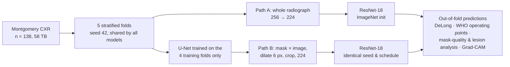
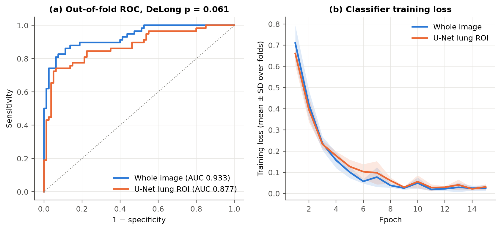
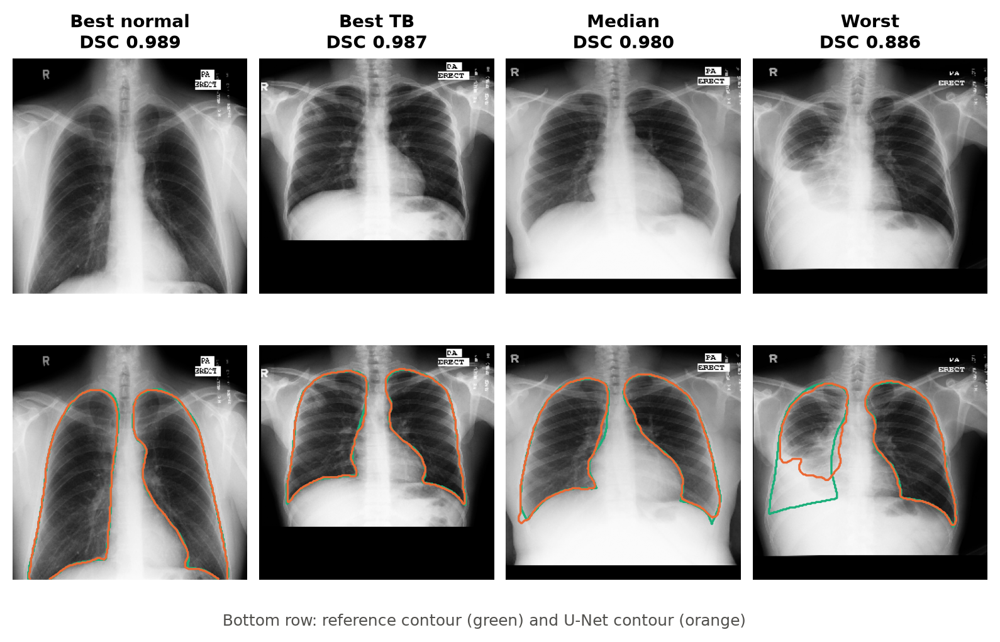
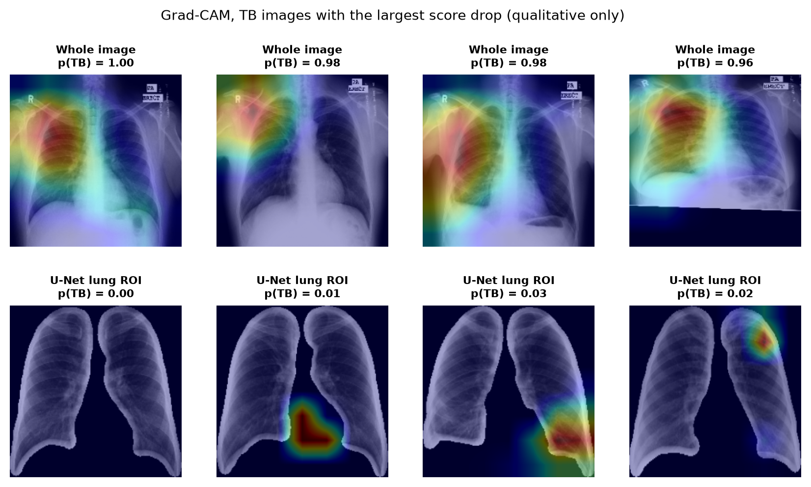

# Does lung segmentation help TB detection on chest X-rays?

**A matched U-Net + ResNet-18 study on the Montgomery County dataset: code for the paper**

> Haider A, Ullah I, Hakeem S, Ali K. *Accurate Lung Segmentation Does Not Improve Deep Learning Detection of Tuberculosis on Chest Radiographs: A Controlled U-Net and ResNet-18 Study.* Pak J Med Cardiol Rev. 2026;5(1):7719–7746. [doi:10.66021/pakmcr1834](https://doi.org/10.66021/pakmcr1834)


Many TB screening pipelines put a lung-segmentation network in front of the classifier, on the assumption that removing non-lung anatomy helps. This repository tests that assumption under **matched conditions**. The two pipelines share the same folds, network, initialisation, augmentation and schedule. **The classifier input is the only thing that differs.**

**Main finding (paper):** the U-Net segments the lungs almost perfectly (Dice 0.976), yet feeding ResNet-18 only the segmented lungs **lowers** TB AUC from 0.946 to 0.882 (DeLong p = 0.017). At 90% sensitivity, specificity drops from 83.8% to 48.8%, so only the whole-image model meets the WHO triage target. The loss is largest on *well*-segmented images of old, fibrotic disease. That points to evidence removed by design (hila, mediastinum, apices, lung size), not to segmentation errors.

---

## Study design



**No leakage between the two stages.** For fold *k*, the lung masks fed to the lung-ROI classifier come from a U-Net trained only on fold *k*'s training images. So neither network ever sees that fold's test images. Every reported number is computed on the 138 out-of-fold predictions.

## Quick start

```bash
git clone https://github.com/OWNER/tb-lung-segmentation-study.git
cd tb-lung-segmentation-study
python -m venv .venv && source .venv/bin/activate      # Windows: .venv\Scripts\activate
pip install -e ".[dev]"

pytest -q                         # unit tests (statistics, metrics, folds, pipeline)
python -m tbstudy smoke           # ~2-minute end-to-end check on a synthetic dataset
```

## Data

The [Montgomery County chest X-ray set](https://data.lhncbc.nlm.nih.gov/public/Tuberculosis-Chest-X-ray-Datasets/Montgomery-County-CXR-Set/MontgomerySet/index.html) (U.S. National Library of Medicine) contains 138 posteroanterior radiographs: 80 normal and 58 TB. It includes manual lung masks and short clinical readings. The data are not redistributed here.

```bash
python scripts/download_montgomery.py --out data/MontgomerySet     # ~600 MB
```

Expected layout: `data/MontgomerySet/{CXR_png, ManualMask/leftMask, ManualMask/rightMask, ClinicalReadings}`.

## Reproduce the paper

```bash
python -m tbstudy all --data-dir data/MontgomerySet       # or step by step:
python -m tbstudy prepare  --data-dir data/MontgomerySet  # 256×256 cache, readings, folds.csv
python -m tbstudy segment                                 # 5 fold-specific U-Nets + Otsu baseline
python -m tbstudy classify                                # 10 ResNet-18s (5 folds × 2 inputs)
python -m tbstudy analyze                                 # tables, statistics, figures, Grad-CAM
```

The full experiment was designed to run on a laptop CPU in under an hour. The paper reports about 4.3 min per U-Net fold and 2.3 min per ResNet-18 fold on one CPU core. A GPU is used automatically if present (`--device cuda|mps|cpu`).

Outputs are written to `outputs/`:

| File | Content |
|---|---|
| `outputs/results/RESULTS.md` | every table of the paper (cohort, segmentation, classification, operating points, folds, subgroups), with this run beside the published values |
| `outputs/results/results.json` | all numbers, machine-readable |
| `outputs/results/figures/*.png` | segmentation examples, learning curves, Bland–Altman, ROC, score distributions, confusion matrices, fold-wise and subgroup plots, Grad-CAM |
| `outputs/classification/oof_predictions.csv` | out-of-fold TB probability for every image, both conditions |
| `outputs/folds.csv` | the fold assignment used by all models |

## Results

All values are out-of-fold (n = 138). The *Reimplementation* column comes from running this repository once on a laptop CPU. Full tables are in [`results/RESULTS.md`](results/RESULTS.md).

| Quantity | Paper | Reimplementation |
|---|---|---|
| U-Net Dice (all / normal / TB) | 0.976 / 0.981 / 0.969 | **0.975 / 0.980 / 0.968** |
| U-Net HD95 (px at 256²) | 3.33 | 3.48 |
| Lung-area bias (pp), Pearson r | −0.48 | −0.33, r = 0.992 |
| Otsu + CLAHE baseline Dice | 0.607 | 0.773 ¹ |
| AUC, whole image | 0.946 (0.907–0.975) | **0.933** (0.885–0.969) |
| AUC, U-Net lung ROI | 0.882 (0.814–0.938) | **0.877** (0.811–0.934) |
| ΔAUC (ROI − whole), DeLong p | −0.064, p = 0.017 | **−0.056**, p = 0.061 |
| Folds where whole image beats lung ROI | 5 / 5 | 5 / 5 |
| Sensitivity at 0.5 (whole / ROI) | — | 0.897 / 0.741 |
| Specificity at ≥ 90% sensitivity (whole / ROI) | 0.838 / 0.488 | 0.600 / 0.475 ² |
| Spearman ρ, score drop vs. mask Dice (TB images) | 0.36 (p = 0.006) | **0.37** (p = 0.004) |

**Replication summary.** The segmentation results reproduce almost exactly. The classification result reproduces in direction and size: the lung-ROI model is worse in all five folds, with a ΔAUC of −0.056 vs. −0.064 in the paper. In this run the pooled DeLong test falls just short of significance (p = 0.061 vs. 0.017), so the paper's p-value should be read as fragile at n = 138. The mechanism analysis also reproduces. The probability drop is *largest on the best-segmented TB images* (ρ = 0.37), and TB sensitivity falls by about 15–17 points for both pleural and inactive or scarred disease. Removing anatomy, rather than segmentation error, drives the loss.

¹ The baseline is a reimplementation of a loosely specified method (CLAHE and morphology parameters are assumptions); it is a reference only and plays no role in the main comparison.
² Specificity at a fixed sensitivity is unstable with 58 TB cases. Here, 52/58 TB detected (89.7%) allows a specificity of 0.81, but reaching 53/58 (91.4%) drops it to 0.60. The bootstrap CI (0.47–0.95) reflects this.

<p align="center">
  <br>
  <br>
  
</p>

## Implementation notes

The code follows the paper's Methods section and Table 5. A few details the paper does not fix are marked `[assumption]` in [`src/tbstudy/config.py`](src/tbstudy/config.py):

- **U-Net:** 4 levels (16 → 256 filters), 3×3 conv–BN–ReLU blocks without conv bias, and 2×2 transposed convolutions. That gives **1,942,289 parameters**, exactly as reported (checked in `tests/`). Trained at 128×128 with BCE + soft Dice, Adam 1e-3, cosine schedule, batch size 8, 50 epochs. Masks are evaluated at 256×256 after thresholding at 0.5, keeping the two largest components and filling holes. Input standardisation is per-image z-score `[assumption]`.
- **Classifier:** ImageNet ResNet-18 with one output logit, AdamW 1e-4 (weight decay 1e-4), cosine schedule, batch size 16, 15 epochs. Each fold seeds both conditions identically, so the head initialisation and the order of mini-batches match. No early stopping and no threshold tuning on test folds.
- **Augmentation:** rotation, isotropic scaling, translation, and brightness/contrast changes (exact magnitudes `[assumption]`). No horizontal flips, because they would put the heart on the wrong side.
- **Statistics:** fast DeLong test for correlated AUCs (Sun & Xu, 2014), 2,000-sample bootstrap CIs, exact McNemar test, and Wilson intervals. Also the Youden point, specificity at ≥90% sensitivity, sensitivity at ≥95% specificity, Brier score, and confirmatory-test demand (paper Eqs. 5–6).
- **Lesion subgroups:** found by keyword search of the clinical readings (`pleur`/`effusion`; `inactive`/`scar`/`calcif`/`stable`). The paper reports 13 and 24 TB readings in these groups. `RESULTS.md` prints the counts so you can check them.

This is a clean, tested reimplementation of the published protocol. Small numerical differences from the paper are expected with a different PyTorch version, hardware or random-number stream. The statistical conclusions are what a replication should be judged on.

## Repository structure

```
src/tbstudy/
  config.py        all hyper-parameters, each marked [paper] or [assumption]
  data.py          Montgomery loading, 12-bit → 8-bit, clinical readings, stratified folds
  models.py        U-Net, BCE + Dice loss, ResNet-18 head
  transforms.py    paired affine + intensity augmentation (no flips)
  postprocess.py   two-largest-components, hole filling, dilation, lung-ROI crop
  baseline.py      CLAHE + two-stage Otsu lung segmentation
  train_seg.py     stage 1: fold-specific U-Nets
  train_cls.py     stage 2: whole-image vs lung-ROI ResNet-18
  seg_metrics.py   Dice, IoU, sensitivity, precision, HD95, lung area
  stats.py         DeLong, bootstrap, McNemar, Wilson, operating points, test demand
  gradcam.py       Grad-CAM on layer4
  analyze.py       stage 3: all tables and figures
  synthetic.py     toy dataset for smoke tests
tests/             unit tests: paper's test-demand numbers, fold sizes, U-Net size, ...
scripts/           dataset download
```

## Limitations

The dataset is small and comes from a single site, so confidence intervals are wide. A few TB patients have more than one image, and the file names do not identify patients, so those images may fall into different folds. Grad-CAM is used only qualitatively. See the paper's *Limitations* section for the full discussion.

## Citation

```bibtex
@article{haider2026lungseg,
  title   = {Accurate Lung Segmentation Does Not Improve Deep Learning Detection of Tuberculosis
             on Chest Radiographs: A Controlled {U-Net} and {ResNet-18} Study},
  author  = {Haider, Adnan and Ullah, Ikram and Hakeem, Summiya and Ali, Kamran},
  journal = {Pakistan Journal of Medical \& Cardiological Review},
  volume  = {5}, number = {1}, pages = {7719--7746}, year = {2026},
  doi     = {10.66021/pakmcr1834}
}
```

Please also cite the dataset: Jaeger S. et al., *Quant Imaging Med Surg* 2014;4(6):475–477, and Candemir S. et al., *IEEE Trans Med Imaging* 2014;33(2):577–590.

## License

MIT for the code. The Montgomery data remain under the U.S. National Library of Medicine's terms. This is research code, not a medical device.
